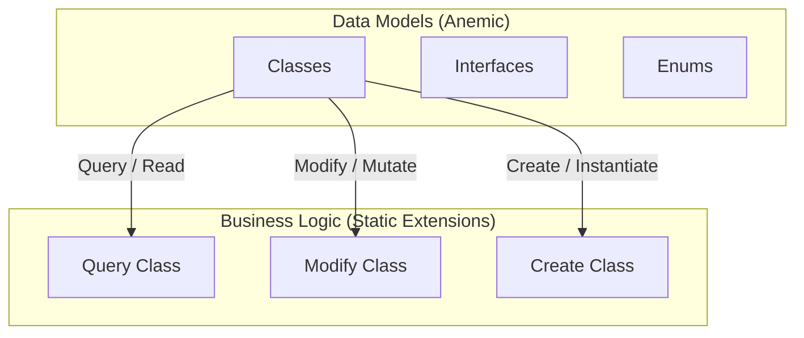

# DiGi.YOLO

**DiGi.YOLO** is a C# engineering and architectural software library suite designed for BIM and CAD integrations (such as Revit, RhinoCommon, Grasshopper, and Dynamo BIM).

---

## 🏗️ Project Architecture & Assemblies

The repository contains the following core components and assemblies:
* **[DiGi.YOLO](DiGi.YOLO)** (Path: `DiGi.YOLO\DiGi.YOLO`)

---

## 📖 Documentation & Guides

Comprehensive guides and operational documentation are available in the [DiGi.YOLO GitHub Wiki](https://github.com/DiGi-Organization/DiGi.YOLO/wiki):
* **[Year Built Prediction Pipeline](https://github.com/DiGi-Organization/DiGi.YOLO/wiki/Year-Built-Prediction-Pipeline):** End-to-end architecture, frozen weights provenance, Python requirements, database row scoping, and superseding the legacy file-based workflow.
* **[Running Scripts Manually](https://github.com/DiGi-Organization/DiGi.YOLO/wiki/Running-Scripts-Manually):** Standalone execution guide for `predict.py`, `train.py`, and `export.py`.
* **[ConsoleApp Operator Guide (DiGi.GIS.YOLO.UI)](https://github.com/DiGi-Organization/DiGi.GIS.YOLO.UI/wiki/Using-the-ConsoleApp):** Complete operational manual for the headless runner `DiGi.GIS.YOLO.UI.ConsoleApp.exe`.

---

## 🤖 YOLO Model & Execution Pipeline

### Frozen Weights Provenance
The pipeline depends on one frozen checkpoint, `YOLO/models/model.pt`. Since 2026-10-08 that is **`train9_fresh`**, selected by the detector gate of [DiGi.GIS.YOLO.UI#12](https://github.com/DiGi-Organization/DiGi.GIS.YOLO.UI/issues/12) and shipped together with the year-built regressor fitted to its features ([DiGi.GIS.ML#13](https://github.com/DiGi-Organization/DiGi.GIS.ML/issues/13)). The values below are read out of the checkpoint itself (`version`, `date`, `train_args`) and its run's `results.csv`, not recorded by hand:

| | `train9_fresh` (shipped) | `train8` (previous; the rollback) |
|---|---|---|
| Architecture | YOLO26x (`yolo26x.yaml`), 58 810 878 parameters, `nc = 1` `{0: 'Building'}` | YOLOv8x (`yolov8x.yaml`), 68 153 571 parameters, `nc = 1` |
| Saved | 2026-10-07 (best epoch) | 2025-05-23 |
| ultralytics | 8.4.165 | 8.3.130 |
| Epochs run / best | 150 / 145 (val mAP50-95 0.9327) | 150 |
| Patience | 50 | 100 |
| Image size / batch / seed | 640 / 16 / 0 | 640 / 16 / 0 |
| Optimizer / AMP | `auto` / on | `auto` / on |
| **Started from** | **`base/yolo26x.pt`**, SHA-256 `9fdd44a31c504547ffb81d2c6d9e6dac3493c8eaa8b0398d3f43bae6c7003e92`. `train_args.model` reads `…\train9_fresh\weights\last.pt` because the run was resumed twice, once from the tray and once automatically; the true start is the base checkpoint | `runs/detect/train7/weights/best.pt`, a continuation of `train7` |
| Dataset | rebuilt from the database by `--dataset` of DiGi.GIS.YOLO.UI#13: 25 008 labelled buildings over 217 counties, Train / Validate / Test 18 057 / 1 995 / 4 956, 228 569 images | lost; only the weights survive |
| Bytes | 118 333 605 | 136 730 810 |
| SHA-256 | `2dd833e438ffcb1352ae7675063c9f0c97ca1c39ce6410a0bfab96e8b3cbdc9a` | `c79d2edfb776c913494d698cd1899ed1a6c92d7caad594b674d39ce5ada7ea38` |

**Gate** (2026-10-07, same Test split; first-detection-year error in years against the label; *clean* = Test buildings `train8` cannot have seen, n = 179):

| Weights | Test mAP50 / mAP50-95 | All MAE / RMSE / exact | Clean MAE / RMSE / exact |
|---|---|---|---|
| `train8` | 0.979 / 0.813 | 0.503 / 1.907 / 0.883 | 2.235 / 4.342 / 0.598 |
| **`train9_fresh`** (selected) | 0.993 / 0.934 | 0.353 / 1.789 / 0.935 | 1.855 / 4.223 / 0.704 |

**Rejected candidate:** `train9_continue` (YOLOv8x continued from `train8`, 100 epochs, SHA-256 `382a9041af92e1e086704f214ee74ffaa46e14037d082724710b583eaee29bf8`): Test mAP 0.993 / 0.930; all 0.338 / 1.716 / 0.937; clean 1.883 / 4.196 / 0.704. It was practically tied with `train9_fresh`, and the gate's tie-break names the fresh candidate for its fully known history.

The shipped weights live in the git-ignored `user files/YOLO/models/model.pt`, the only file of `YOLO` the runner deployment carries. `train8`, the rejected candidate and the ONNX exports are kept in the training directory outside the workspace, as rollback and evaluation baselines.

To read these back from any `.pt` without installing torch: the file is a zip, and `data.pkl` inside it unpickles to a dictionary carrying `version`, `date` and `train_args`.

### Pretrained Base Checkpoint
New detectors are trained from the latest ultralytics pretrained weights rather than continued from `train8` alone ([#17](https://github.com/DiGi-Organization/DiGi.YOLO/issues/17)). The checkpoint is fetched once, never downloaded implicitly at train time, and stored in the git-ignored `user files/YOLO/models/base/`:

| | |
|---|---|
| File | `yolo26x.pt` (COCO, 80 classes) |
| Source | [ultralytics/assets `v8.4.0`](https://github.com/ultralytics/assets/releases/download/v8.4.0/yolo26x.pt) |
| Written by | ultralytics 8.3.222, 2025-12-30 |
| Parameters | 58 993 368 |
| Bytes | 118 667 365 |
| SHA-256 | `9fdd44a31c504547ffb81d2c6d9e6dac3493c8eaa8b0398d3f43bae6c7003e92` |

ultralytics 8.3.130 cannot load it; `check.py` reports a warning when the installed ultralytics is older than the version that wrote the model it is given. An ONNX export of a YOLO26 detector made with `nms` at its default (`None`, no NMS embedded) answers the raw `[batch, 4 + nc, 8400]` one-to-many head layout, so the in-process decoder is unchanged. Under ultralytics 8.4.165, passing `nms=False` would select the one-to-one NMS-free head and change the output shape.

Both start points train under 8.4.165: a 3-epoch smoke run (2026-09-29, RTX 5090, batch 16, imgsz 640, 240 images pseudo-labelled by `model.pt`) completed from `yolo26x.pt` and from `model.pt`, and each `best.pt` reloads and predicts. YOLO26 trains without the DFL loss term, so its loss columns differ from `train8`'s. Real runs belong to the argument-driven `train.py` ([#16](https://github.com/DiGi-Organization/DiGi.YOLO/issues/16)).

### Frozen ONNX Export Provenance
The same detector is also scored in process, without an interpreter, by
[DiGi.YOLO.ONNX](https://github.com/DiGi-Organization/DiGi.YOLO.ONNX). That path consumes an ONNX export of the checkpoint above, produced once by `export.py`. The export is as frozen as the checkpoint it came from, so it is recorded the same way - by a digest read off the artefact:

| | `train9_fresh` (current) | `train8` (previous) |
|---|---|---|
| Exported | 2026-10-07 ([DiGi.YOLO.ONNX#2](https://github.com/DiGi-Organization/DiGi.YOLO.ONNX/issues/2)) | 2026-09-03 |
| Exported by | ultralytics 8.4.165, Python 3.13, torch 2.7.0+cu128, onnx 1.22.0, onnxslim 0.1.96 | ultralytics 8.3.130, torch 2.7.0+cu128, onnx 1.22.0, onnxslim 0.1.96 |
| Flags | `format=onnx`, `imgsz=640`, `opset=12`, `dynamic=True`, `simplify=True`, `half=False`, `nms` unset ([#20](https://github.com/DiGi-Organization/DiGi.YOLO/issues/20)) | the same, with `nms=False` (under 8.3.130 only "do not embed NMS") |
| Metadata | `end2end: False` | — |
| Bytes | 224 047 962 | 273 083 173 |
| SHA-256 | `27ec80105e0215cde9cf091989310446c8703a49a30b5826ee0efea3382471a8` | `7cfb1a79209fa27a43f07a2151dfebaad3baedf93c94bc25a92a6bdbc4040213` |

Both graphs are `nc = 1` (`{0: 'Building'}`) and answer `[batch, 5, anchors]` (8 400 at 640). `dynamic=True` is what lets the C# runner feed whole batches; a static export pins the batch to one. `nms` is left at its default (`None`, no NMS embedded in the graph) - suppression stays on the C# side, where it can be matched to the thresholds ultralytics applies internally (IoU `0.7`, at most `300` detections) rather than baked into the graph. Under ultralytics 8.4.165, explicitly passing `nms=False` would select the one-to-one NMS-free head (output shape `[batch, 300, 6]`), which is not the layout the in-process decoder expects.

The export is not in git. The runner does not read it, so it is not deployed either. It is kept in the training directory and beside DiGi.YOLO.ONNX's parity fact.

### Python Helper Scripts & Requirements
`DiGi.YOLO` embeds Python helper scripts (`train.py`, `val.py`, `predict.py`, `export.py`, `check.py`, `utils.py`, `requirements.txt`, `conf.yaml`) as binary resources.
* **Script Export:** Callers can extract these runner scripts without instantiating a `YOLOModel` by calling `Modify.WriteScripts(targetDirectory)`. The scripts are rewritten on every call; the template `conf.yaml` is written only into a directory that has none, so it never replaces the `conf.yaml` of a dataset.
* **Training (`train.py`) and validation (`val.py`):** argument driven - see *Training a Detector from C#* below.
* **Inference (`predict.py`):** Supports command-line options:
  - `--model`: Path to trained YOLO `.pt` model weights file (default: `YOLO/models/model.pt`).
  - `--source`: Path to input image file or directory containing images (default: `YOLO/input`).
  - `--conf`: Confidence threshold float (default: `0.1`).
  - `--output`: Output filepath for bounding box results (`.bbrf`) in write mode (`"w"`) (default: `YOLO/output/results.bbrf`).
  - `--batch`: Images per model call (default: `32`).
  - `--workers`: Threads that decode the next batch while the GPU detects the current one (default: `2`; `0` lets ultralytics read the files itself). Decoding uses ultralytics' own `imread`, so the detections are byte-identical.
  - `--half`: FP16 inference, passed to ultralytics as `quantize=16` (8.4 deprecates `half` and logs a warning on every call). Changes confidences, so detections can change; off by default.
  - `--imgsz`: Inference size; omitted, ultralytics uses `640`, the size `model.pt` was trained at (320 px tiles scaled up twice). Another size changes the detections.
  - Options left at their defaults are not passed to the model, so a default run is the call earlier builds made. The `.bbrf` format is fixed: no header, `name` alone for an image without a box, otherwise one tab-separated line per box; chunk results are joined by concatenation.
  - The last stderr line is `predict: images=… seconds=… rate=… load_seconds=… first_batch_seconds=… write_seconds=… preprocess_ms=… inference_ms=… postprocess_ms=… device=… imgsz=… half=… batch=… workers=…` - the detection loop's rate and its per-phase split, carried in `YOLOPredictionResult.StandardError`. It is a log line, not a contract.
  - **Measured settings ([#24](https://github.com/DiGi-Organization/DiGi.YOLO/issues/24)).** 50 000 images of 320 × 320 px, `train9_fresh` (SHA-256 `2dd833e4…`), RTX 5090, ultralytics 8.4.165, torch 2.7.0+cu128, compared against the shipped script. Two baseline runs were byte-identical, so "identical" below means byte-identical:

    | Setting | images/s | `.bbrf` against the baseline |
    |---|---|---|
    | before #24 (baseline, 2 runs) | 155.6 / 154.4 | — |
    | `--workers 0` (ultralytics reads the files) | 156.4 / 150.9 | identical |
    | `--workers 1` / `2` (3 runs) / `3` | 166.3 / 165.7 median / 164.3 | identical |
    | `--workers 4` / `8` | 155.6 / 158.4 | identical; the prefetch threads contend for the GIL |
    | `--batch 64` / `128` | 153.0 / 148.9 | edges move up to 3.5 px, confidences up to 0.002; no year changes; 19 / 32 GB VRAM |
    | `--workers 2 --half` | 229.2 | 7 images change detection count; 3 of 5 506 buildings change year |
    | `--workers 2 --imgsz 320` | 657.3 | unusable: 3 of 5 506 buildings dated |

    The GPU is busy about 77 % of the time even before #24: of about 6.3 ms per image, 4.7 ms is inference at 640 px, so overlapping the decode can win only the remainder. `--workers 2` is therefore the default; `--half` and `--imgsz` stay opt-in because they change the detections.
* **Export (`export.py`):** Turns the frozen checkpoint into the ONNX graph the in-process detector scores with. Options: `--model`, `--output`, `--imgsz` (default `640`), `--opset` (default `12`), `--static` (fixed axes instead of a dynamic batch). It prints the size and SHA-256 of what it wrote, which is what the provenance table above records. This is a one-off preparation step - it is why removing the Python dependency removes it from every *run* rather than from the repository.
* **Python Environment:** `pip install -r requirements.txt`. `ultralytics` is pinned exactly (`==8.4.165`; the shipped `train9_fresh` was trained and written by 8.4.165; the previous `train8` was written by 8.3.130, and 8.4.165 was adopted in #17 only after reproducing its detections on 1 000 held images - identical counts, box edges within 0.017 px) because a different ultralytics can be a different detector; `torch` is a floor (`>=2.6`) because its wheels are specific to a platform and CUDA build. The file itself carries the reasoning. `onnx` and `onnxslim` sit under an export-only heading there: `export.py` needs them and nothing that runs a prediction does.
* **Two ultralytics environments:** the main Python above carries the pinned 8.4.165; 8.3.130 is kept in the git-ignored `user files/YOLO/venv-ultralytics-8.3.130/` venv for the frozen `train8` checkpoint's parity and export path. The two must not share a settings file: ultralytics reads and writes one `settings.json` per machine, and the schemas differ (8.3.130 is v0.0.6, 8.4.165 is v0.0.8 with the `comet`/`openvino_msg` keys). Whichever version runs after the other finds a schema it does not expect, rewrites the file, prints a settings notice to stdout - into the stream `check.py` carries its JSON payload in - and, in the 8.3.130 direction, resets the settings to its own defaults, losing custom values such as `runs_dir` or `datasets_dir` without notice.
* **Settings isolation (`YOLO_CONFIG_DIR`):** every run the C# runners start (the preflight `Query.YOLOEnvironmentResult`, `Modify.Predict`, and the training of #16) sets `YOLO_CONFIG_DIR` to a `.yolo-config` folder inside its working directory, so the settings file the run reads and writes lives in that working directory and is never the shared machine-wide one. The venv is isolated the same way for interactive use by its own activation scripts - `Scripts/activate`, `Scripts/Activate.ps1` and `Scripts/activate.bat` set `YOLO_CONFIG_DIR` to a `.yolo-config` folder inside the venv and restore the previous value on deactivate. The venv is git-ignored, so that part is a machine-local setup; the three lines to add are:
  ```bash
  export YOLO_CONFIG_DIR="$VIRTUAL_ENV/.yolo-config"                 # Scripts/activate
  $env:YOLO_CONFIG_DIR = Join-Path $env:VIRTUAL_ENV ".yolo-config"   # Scripts/Activate.ps1
  set "YOLO_CONFIG_DIR=%VIRTUAL_ENV%\.yolo-config"                   # Scripts/activate.bat
  ```
  The two versions write different paths under one directory - 8.3.130 writes `<dir>\settings.json`, 8.4.165 writes `<dir>\Ultralytics\settings.json` - which is why one working directory can host both; if a future ultralytics changes that layout, the isolation breaks, and the `YOLOEnvironmentResult_SettingsIsolation` test in `DiGi.YOLO.xUnit` pins both paths. The first run in a fresh working directory still prints the one-time `Creating new Ultralytics Settings` notice; afterwards the runs are quiet.
* **`check.py` stdout contract:** the JSON payload sits between the `YOLO_CHECK_JSON_BEGIN` and `YOLO_CHECK_JSON_END` marker lines; everything else on stdout - the ultralytics banner and settings notices included - is noise a caller must not parse.

### Running a Prediction from C#
`Modify.Predict` runs `predict.py` in a CPython process and reports the run. `DiGi.Scripting.Python` is IronPython and cannot host `ultralytics`/`torch`, so it is not an alternative.

```csharp
YOLOPredictionOptions? yOLOPredictionOptions = Create.YOLOPredictionOptions(null, pathWeights, directorySourceImages, pathBoundingBoxResultFile);

YOLOPredictionResult? yOLOPredictionResult = yOLOPredictionOptions.Predict(cancellationToken);

BoundingBoxResultFile? boundingBoxResultFile = Create.BoundingBoxResultFile(yOLOPredictionResult);
```

* `Create.YOLOPredictionOptions(...)` resolves the interpreter (a `null` path searches `PATH` for `python`, then `python3`), normalises the paths and returns `null` when the combination cannot make a run.
* `BatchSize`, `Workers`, `HalfPrecision` and `ImageSize` map to `--batch`, `--workers`, `--half` and `--imgsz`; set them on the options `Create.YOLOPredictionOptions` returns. `Query.PredictArguments(options)` is the command line the runner starts.
* The runner rewrites the scripts in the working directory on every run (an older `predict.py` would exit with code 2 on a flag it does not know), removes a stale `.bbrf` so a failed run cannot be read as this one, and answers a source directory holding no images without starting a process.
* `YOLOPredictionResult` carries the exit code, the tail of both output streams, the image count and the run's `DateTimeOffset` bounds. `Create.BoundingBoxResultFile(result)` gives `null` for a run that did not complete.
* Cancelling kills the interpreter only - `netstandard2.0` has no process-tree kill, so torch worker processes can outlive it.

### Training a Detector from C#
`Modify.Train` runs `train.py` and `Modify.Validate` runs `val.py`, the same way `Modify.Predict` runs `predict.py` ([#16](https://github.com/DiGi-Organization/DiGi.YOLO/issues/16)). A dataset is written with `Modify.Write(YOLOModel)`, whose `conf.yaml` carries an absolute `path:` and the labels.

```csharp
YOLOTrainingOptions? yOLOTrainingOptions = Create.YOLOTrainingOptions(null, pathStartWeights, pathConfigurationFile);
yOLOTrainingOptions!.Name = "train9_fresh";

YOLOTrainingResult? yOLOTrainingResult = yOLOTrainingOptions.Train(cancellationToken);

YOLOValidationOptions? yOLOValidationOptions = Create.YOLOValidationOptions(null, yOLOTrainingResult?.WeightsPath, pathConfigurationFile);
YOLOValidationResult? yOLOValidationResult = yOLOValidationOptions.Validate(cancellationToken);
```

| `train.py` argument | Default | `YOLOTrainingOptions` |
|---|---|---|
| `--model` | `YOLO/models/model.pt` | `ModelPath` - start weights, a local file: a `.pt` checkpoint (`model.pt` to continue the shipped detector, or `base/yolo26x.pt` for a fresh start) or a `.yaml` architecture definition. Nothing is downloaded by name |
| `--data` | `conf.yaml` | `ConfigurationFilePath` - always passed absolute |
| `--epochs` / `--patience` | `150` / `50` | `Epochs` / `Patience` - upper bound and early stopping |
| `--imgsz` / `--batch` / `--seed` | `640` / `16` / `0` | `ImageSize` / `Batch` / `Seed` - `train8`'s values |
| `--project` / `--name` | ultralytics defaults | `Project` (always passed, `<working>\runs\detect` by default) / `Name` |
| `--device` | ultralytics default | `Device` |
| `--amp` / `--no-amp` | on | `Amp` |

* **Start weights** are identified by the runner before the process starts - path, SHA-256 and kind (`checkpoint` / `definition`) on `YOLOTrainingResult` - because the output streams keep only their tail. `train.py` also prints them, and a checkpoint's `train_args` (for `train8` the only surviving record of its settings).
* **Output weights** are read from the block `train.py` prints last (`Weights:`, `Bytes:`, `SHA256:`, `AMP:`) and confirmed against the file on disk; `Succeeded` requires the match.
* **Never into `YOLO/models`:** a run whose project folder lies inside a `YOLO\models` folder is refused, and ultralytics numbers a taken run name rather than reusing its directory, so no run replaces the frozen `model.pt`.
* **Preflight and isolation:** a checkpoint is preflighted with `Query.YOLOEnvironmentResult` (an ultralytics too old for the checkpoint is refused), and the run gets its own `YOLO_CONFIG_DIR`. The scripts are rewritten before every run, so a directory never trains with a `train.py` of an older build.
* **Stall detection ([#22](https://github.com/DiGi-Organization/DiGi.YOLO/issues/22)):** a training that stops producing output for `YOLOTrainingOptions.InactivityTimeout` (default 15 minutes, `null` or non-positive to disable) is ended together with the worker processes it started - a deadlocked run leaves every process alive at 0 % CPU holding the GPU - and reported through `YOLOTrainingResult.Stalled` with the reason in the standard-error tail, distinct from a cancellation and from a crash. A piped training writes a progress line per batch during every phase, so 15 minutes is a large margin over the sub-second cadence of a healthy run. Cancelling a run ends the whole process tree as well.
* **Downloads at train time:** ultralytics' AMP check downloads `yolo26n.pt` into the `weights` folder of the working directory and, offline, silently trains in full precision - `YOLOTrainingResult.Amp` reports the precision actually used. It also downloads `Arial.ttf` into the settings directory. Neither changes the start weights.
* **YOLO26 loss columns:** a YOLO26 run has no `dfl_loss` in its `results.csv`; nothing here reads it.
* **Validation:** `val.py --split val|test` (default `test`) prints `mAP50:` and `mAP50-95:`; `YOLOValidationResult` carries both with the SHA-256 of the weights it measured, so a gate table names exactly which file each row is.

#### Resuming an interrupted run
A run stopped mid-epoch (a power cut, a killed interpreter, a closed console) leaves an unfinished `<project>\<name>\weights\last.pt` that still carries its optimizer and EMA state. `Modify.Train` continues it when `YOLOTrainingOptions.ResumePath` names that file ([#21](https://github.com/DiGi-Organization/DiGi.YOLO/issues/21)):

```csharp
YOLOTrainingOptions yOLOTrainingOptions = new()
{
    PythonPath = pathPython,
    ResumePath = Path.Combine(pathProject, "train9", "weights", "last.pt"),
    Device = "0",
    WorkingDirectory = pathDatasetDirectory
};

YOLOTrainingResult? yOLOTrainingResult = yOLOTrainingOptions.Train(cancellationToken);
```

```powershell
python train.py --resume "C:\YOLO\runs\detect\train9\weights\last.pt" --device 0
```

* **What is resumable:** a checkpoint ultralytics left unfinished. It stores `epoch >= 0` and an optimizer state right up to the last epoch; a finished run's `last.pt` is stripped to `epoch = -1` with no optimizer, and nothing can be resumed from it. `Query.YOLOCheckpointInformation(path)` reads either - the 1-based completed `Epoch`, the `Epochs` ceiling, `Finished`, `DataPath`, `Project`, `Name` and the raw `TrainArguments` - with `checkpoint.py` and no ultralytics.
* **What a resume may change:** `train.py` passes **only** `--resume` and `--device`. Ultralytics restores every other argument from the checkpoint's `train_args`; its `check_resume` accepts a handful of overrides (`imgsz`, `batch`, `device`, `patience`, `close_mosaic`, ...), ignores the rest with a warning, and would **silently start a fresh run** if handed a finished checkpoint - so the guard that refuses one is in `train.py`, not delegated to ultralytics. The epoch ceiling is fixed by the checkpoint: a different ceiling is a new run, not a resume.
* **Refusals before launch:** `Modify.Train` refuses, naming the reason and starting no process, a resume path that is missing or not a `.pt`, a finished checkpoint, a checkpoint whose `train_args.data` no longer exists, and a run folder inside a `YOLO\models` folder.
* **Not bit-identical:** a resumed run restarts the data loader's random state, so it is not byte-for-byte the uninterrupted run. `YOLOTrainingResult.Resumed` is `true` and `ResumedFromEpoch` names the 1-based epoch it entered (a checkpoint with one completed epoch resumes into epoch 2), so a provenance table can say so.
* **An interruption costs up to one full epoch:** `last.pt` is written only after the epoch's validation, so a run cut mid-epoch (a stall ended by the inactivity limit, a crash, a power cut) resumes at the start of that epoch and trains it in full again.
* **Launched by hand:** a console-launched run aborts if its console window is closed (`forrtl: error (200): program aborting due to window-CLOSE event` - the Intel Fortran runtime numpy/torch load). Start it with `pythonw`, or keep the console open. A hand-written wrapper must keep `train.py`'s `if __name__ == "__main__":` guard, because Windows data loader workers re-import the main module. Runs started by `Modify.Train` have no console to close.

---

## 📐 Core Architectural Pattern (DiGi.Core Pattern)

This project strictly separates **Data Models** (anemic schemas) from **Business/Calculation Logic** (static extension methods). All new features must strictly follow this pattern.



### 1. Data Models (Classes, Interfaces, Enums)
* **Classes:** Place in the `/Classes` directory (Namespace: `[Project].Classes`). Keep them simple and lightweight (properties and basic constructors only). **Do NOT** put complex logic inside these classes.
* **Interfaces:** Place in the `/Interfaces` directory (Namespace: `[Project].Interfaces`).
* **Enums:** Place in the `/Enums` directory (Namespace: `[Project].Enums`).

### 2. Business Logic (Extension Methods)
ALL complex functionalities, including operations on classes, interfaces, and enums, MUST be implemented as **Extension Methods** inside static partial classes in `/Query`, `/Modify`, `/Create`, or `/Convert` directories:
* **Query (Read/Extract):** Static partial class `Query` returning results based on a query without modifying the source object.
* **Modify (Update/Mutate):** Static partial class `Modify` modifying the state or properties of the existing object in place.
* **Create (Instantiate):** Static partial class `Create` instantiating and returning a new object.
* **Convert (Parse/Format/Transform):** Static partial class `Convert` converting, formatting, or transforming an object into another representation.

---

## 💻 Coding Guidelines for Developers & AI Agents

All developers and AI agents follow these always-applicable rules (Visual Studio 2026, C#). Task-specific detail lives in
the guidelines listed in §9 — read the one matching the task.

### 1. General coding standards
1. **English only** — identifiers and comments.
2. **No `var`** unless the compiler forces it; target-typed `new()` (`PointNode pointNode = new();`, avoids IDE0090) and
   collection expressions (`List<int> numbers = [];`, avoids IDE0028).
3. **Naming:** camelCase starting with the type name, `_`-suffixed qualifier when needed (`PointNode pointNode_Base`); an
   acronym type lowercases only its first letter (`gISPostgreSQLConverterManager`). Collections: pluralized element type
   (`filterConditions`, `point3Ds` — not `listConditions`). A property named after its unique, descriptive type
   (`public AggregateFunction AggregateFunction { get; set; }`). Primitives: plain camelCase.
4. **Zero warnings/analyzer messages.**
5. **Block-scoped namespaces** (`namespace DiGi.Domain { ... }`); file-scoped are prohibited (`.editorconfig`). Every
   repository builds at `LangVersion latest` with `AnalysisLevel latest-recommended` (template props); core libraries
   target `netstandard2.0` — use `System.Threading.Lock` only in net9+ projects.
6. **Parameter line breaks (`<= 7` rule, `DIGI0001`):** ≤ 7 parameters on one line however long; ≥ 8 one per line. Line
   length is never the trigger. Call sites prefer one line; multi-line for complex expressions, lambdas, initializers.
   ```csharp
   public void Calculate(double centerX, double centerY, double radius, double? storeyHeight = null)
   ```
7. **Async method names end with `Async`.**
8. **`CancellationToken` is always the LAST parameter (CA1068)** — every method and overload; add new optional parameters
   before it and reorder the `<param>` tags. At call sites **name every argument after a skipped default**
   (`commandTimeout: 30`, `cancellationToken: cancellationToken`) so an inserted parameter fails to compile instead of
   rebinding. Detect: `grep -rnE "CancellationToken [a-zA-Z_]+( = default)?, " --include=*.cs .`
   ```csharp
   public static async Task<bool> ClearAsync(NpgsqlConnection? npgsqlConnection, string tableName, int commandTimeout = 30, CancellationToken cancellationToken = default)
   ```
9. **Simplify member access (IDE0002) — then rebuild.** C# binds the first segment innermost-outwards with no fallback:
   from `DiGi.GIS.PostgreSQL.UI.Classes`, `WebAPI` is `DiGi.GIS.WebAPI`, so `DiGi.WebAPI.Query.GetAsync` keeps its prefix.
   When same-named extension methods can both apply, call the intended one fully qualified — the `using` decides silently.
10. **Separate projects**, not one monolithic solution.
11. **Output optimization:** no filler; only the necessary code, logic or explanation.
12. **Temporary code carries `TODO [MarkerName]:`** — a PascalCase name of the **migration**, reused at every site so one
    `grep` is the deletion checklist, stating the observable **removal condition** and the tracking issue. A workaround
    for another DiGi repository's defect is temporary too (removal condition = the upstream fix). Never tag permanent code.
13. **`ToString()` is not a key** — identity strings render through `CultureInfo.InvariantCulture` (`"R"` with `-0.0`
    folded, `G29` for `decimal`); `pl-PL` files `[0,5, 12,25]` and nothing throws. Reference: `DiGi.Typology.Visual.Query.Key`.
14. **A member resolved by name through reflection is a contract on the whole hierarchy** — document it at both ends,
    probe `GetMethod` rather than reason about it.
15. **No caching in an optimization unless the request explicitly allows it** — remove allocations and repeated
    enumeration first; propose a cache with its measurement and ask.
16. **Log through `Serilog.Modify.Log`** with structured templates (`"{Type}: … {CountyId}"`, never interpolation);
    `Log(exception, …)` always logs at Error.
17. **Rethrow only a requested cancellation:**
    `catch (OperationCanceledException) when (cancellationToken.IsCancellationRequested) { throw; }` before any general catch.

### 2. Architecture (DiGi.Core pattern)
Data models are anemic; behavior is static extension methods. Never a service/manager class for behavior (process-wide
registries are `*Manager`s on `Settings` or DI singletons).
- **`/Classes`** (`[Project].Classes`), **`/Interfaces`**, **`/Enums`**. Category folders (`Classes/Options`,
  `/BackgroundTask`, `/Result`, `Convert/ToX`) add **no** namespace segment — it would change the `_type` discriminator.
- **`Query`** (read-only, property-like names: `BoundingBox()`, only `Is`/`Has`/`Try` prefixes), **`Modify`** (mutates),
  **`Create`** (builds), **`Convert`** (`/Convert/To[TargetArea]/[TargetType].cs`, `ToSystem_String`, `ToEPW_DateTime`) —
  `Convert` is the first choice for any conversion, never an instance method on the model.
- **Interface-contract members are instance methods on the class** — geometry primitives (`Polygon2D`, `Circle2D`, …
  implementing `IBoundable2D`, `ITransformable2D`, `IClosedCurve2D`) are deliberately not anemic; never move them.
- **Constructors stay cheap** (assign and clone only); validation and cleanup go in a `Create` factory named after the
  type, returning `null` for invalid input — materialise → clean up → then validate.
- **One public method per file** in `/Query`, `/Modify`, `/Create` (overloads together); nested types in
  `[Outer].[Inner].cs`; **no private methods** in these classes (public helper or local function).
- **`IResult` types end in `Result`** (`TerrainPointDensityResult`); the name is wire contract, so existing violations are
  not renamed opportunistically.
- Enums start with `Undefined` (`-1` only where `0` is real); tolerances come from `DiGi.Core.Constants.Tolerance`
  (`Distance` 1e-6, `MicroDistance`, `MacroDistance`, `Angle`).

### 3. Project assets — `files/` vs `user files/` (never commit secrets)
Committed, non-sensitive deployment assets go in `files/`; **secrets, credentials, machine-specific settings and
generated reports go in the git-ignored `user files/`** (`[Uu]ser [Ff]iles/` in `.gitignore`; verify with
`git check-ignore -v "user files/x.conf"`). Both are copied flat into the output (`CopyUserFiles` runs after `CopyFiles`,
so `user files/` wins) — and `user files/` **ships** with every deploy, so training data and model variants live outside
the workspace. A file a build copies into a project (`gltf-viewer-core.js`, `gis-theme.css`) is edited only at its source.

### 4. Host dependencies — `HintPath` drops a library's NuGet packages
DiGi projects reference each other by `HintPath`, which NuGet and MSBuild cannot follow: a host must **re-declare every
package its libraries need, at the same version** (unless its framework provides it), or it fails at run time with a
`FileNotFoundException` per item — a **partial result reported as success**. `dotnet test` never rebuilds the library
under test: build it first. Verify with `CheckHostDependencies.ps1`.

### 5. References (`IReference` / `IUniqueReference`)
**Never compare two interface-typed references with `==`** (a silent reference comparison; accessors clone per call).
Use `Core.Query.Equals(reference_1, reference_2)`.

### 6. Serialization (`SerializableObject`)
A serializable class implements `I<Project>SerializableObject`, keeps `private readonly` fields tagged
`[JsonInclude, JsonPropertyName(nameof(Prop))]`, exposes them as `[JsonIgnore]` get-only properties, uses
`DateTimeOffset` for dates, and has exactly three constructors:
```csharp
public Holiday(string? name, string? date)
{
    this.name = name;
    this.date = date;
}

public Holiday(Holiday? holiday) : base(holiday)
{
    if (holiday != null)
    {
        name = holiday.name;
        date = holiday.date;
    }
}

public Holiday(JsonObject? jsonObject) : base(jsonObject) { }
```
Copy constructor: primitive lists `new List<T>(source)`, nested objects `Core.Query.Clone(item)` element by element.

### 7. Documentation and tests
- **XML docs:** every public member, params in signature order, one `<summary>`, no blank lines (`<para>`), no docs on
  `partial` declarations. Read `documentation/API/<Assembly>/` before opening `.cs` source.
- **xUnit:** `[ProjectName].xUnit`, `public partial class Facts` in `/Facts`, a `<summary>` on every fact, shared fixtures
  in `DiGi.Test/files/`, written reports in `DiGi.Test/user files/reports/`. Every serializable class gets a fact ending in
  `Core.xUnit.Query.SerializationCheck(instance)` **plus** a direct copy-constructor assertion. Tolerance facts test just
  inside and just outside; benchmarks are measured in isolation with a warm-up. Slow facts are `[MediumFact]`/`[LongFact]`.
- **Interactive front ends** are verified in a real browser (Playwright), asserting rendered output, not state flags.

### 8. Branches and releases
Work is committed on the active version branch (the highest bare SemVer branch, e.g. `0.8.5`) — no feature branch,
worktree or pull request unless asked; push only when asked. **A version bump / release runs only on an explicit request:**
merge the version branch into `main`, bump the patch (`0.8.2` → `0.8.3`), branch it off `main`, update
`Directory.Build.props` `<Major>`/`<Minor>`/`<Build>`, push both (`git push -u origin <version_branch>`).

### 9. Full guideline set
Canonical, task-specific guidelines live in `DiGi.Maintenance/documentation/AI Guidelines/` (relative to the workspace
root) and are mirrored per repository as skills under `.agents/skills/<skill-name>/SKILL.md`.

| Guideline | Read it when |
|---|---|
| `Coding - General.md` | Writing or editing any C# code. |
| `Coding - Serialization.md` | Creating or changing a serializable type or options class; debugging a JSON round trip. |
| `Coding - Host Dependencies.md` | Adding a NuGet package; a host failing with `FileNotFoundException` or a partial result; `CS0012`/`CS0246` build walls. |
| `Coding - Project Setup.md` | New project or repository, `.editorconfig`, `Directory.Build.props`, analyzers. |
| `Coding - Automatic Tests.md` | Writing xUnit facts. |
| `Coding - Performance.md` | Optimizing, benchmarks, parity tests, the wiki `Benchmark.md` page. |
| `Coding - References.md` | Comparing or keying an `IReference` / `IUniqueReference`. |
| `Coding - Geometry.md` | Orienting, closing, triangulating, hashing or sweeping geometry. |
| `Coding - ComputeSharp.md` | Writing or changing a ComputeSharp `IComputeShader`. |
| `Coding - Grasshopper.md` | Grasshopper/Rhino plug-in components. |
| `Coding - Background Tasks.md` | Tray-application background tasks and their dialogs. |
| `Coding - WPF Deferred Loading.md` | A WPF window needing slow data; WPF layout checks. |
| `Coding - YOLO.md` | The YOLO Year Built detector. |
| `Coding - Laya.md` | The Laya decision model. |
| `Coding - WebAPI GLTF.md` | Web APIs on the `DiGi.GLTF` 3D framework. |
| `Coding - WebAPI Contracts.md` | Changing a WebAPI route/parameter/controller or writing an HTTP client. |
| `Coding - WebAPI Simple Authorization.md` | API-key tiered authorization. |
| `Coding - Deployed WebAPI.md` | Testing against `api.digiproject.uk`; which server runs what. |
| `Coding - Browser Testing.md` | Verifying interactive front-end behaviour in a real browser. |
| `Coding - GIS Administrative Data.md` | Anything keyed by a county code or id; the Subdivision layer. |
| `Coding - PostgreSQL.md` | PostgreSQL/Npgsql code, production vs development databases. |
| `Coding - PostgreSQL Distributed Queue Processing.md` | Distributed claim/acknowledge update queues. |
| `XML Documentation.md` | Reading generated API docs; adding or auditing XML docs. |
| `GitHub - Branches and Commits.md` | Where to commit, the pre-commit sweep, plan files, pulling all repos, releases. |
| `GitHub - Issues.md` | Creating, editing, verifying and closing issues; dependencies. |
| `GitHub - Labels.md` | Labels and the mandatory `ai: *` tier. |
| `GitHub - Sub-Issues.md` | Sub-issues for a multi-repository feature. |
| `GitHub - Workspace Setup.md` | Folder layout and new-machine setup. |
| `GitHub Wiki.md` | Editing wiki pages. |
| `Maintenance - Scripts.md` | `DiGi.Maintenance/Scripts`; scripted edits and line endings. |
| `Maintenance - AI Guidelines Propagation.md` | Adding, splitting or removing a guideline. |

> **One data rule worth knowing before it bites you:** a GIS county `code` does **not** identify one row — 406 county
> rows (one per polygon part) cover 380 codes. Key every write and lookup by county **`id`**, give every
> `LIMIT`/`FirstOrDefault` an `ORDER BY`, never deduplicate those rows, resolve every item's part against `building_2d`
> whatever number of ids arrived, and read building-keyed tables with `fallbackByReference: true`
> (`Coding - GIS Administrative Data.md`).
